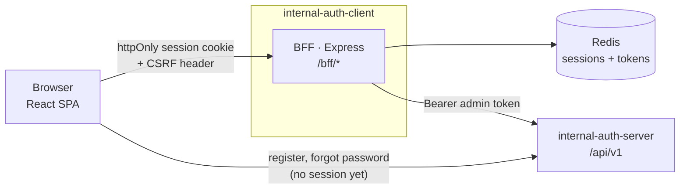
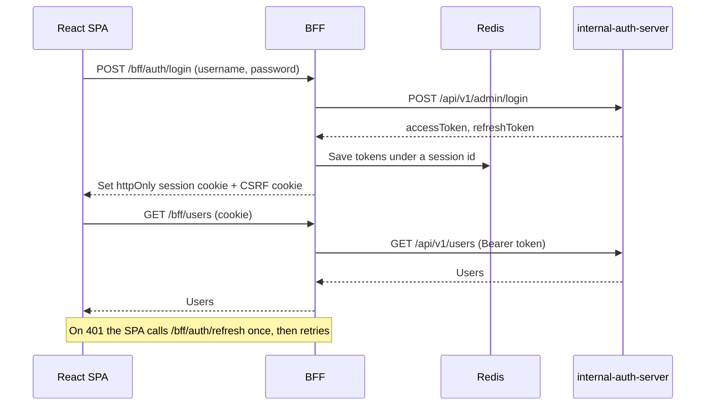

<div align="center">


# Internal Auth Client

**The admin console for Internal Auth Server. Operators manage users, roles, groups, client applications, sessions and signing keys from one place, and no access token ever reaches the browser.**

[](#technology-stack)
[](#technology-stack)
[](#technology-stack)
[](#backend-for-frontend)
[](#progressive-web-app)

</div>

---

## Table of Contents

1. [Project Overview](#project-overview)
2. [The Problem](#the-problem)
3. [The Solution](#the-solution)
4. [Features](#features)
5. [Technology Stack](#technology-stack)
6. [System Architecture](#system-architecture)
7. [Backend for Frontend](#backend-for-frontend)
8. [Authentication Flow](#authentication-flow)
9. [Folder Structure](#folder-structure)
10. [Screens](#screens)
11. [Progressive Web App](#progressive-web-app)
12. [Environment Variables](#environment-variables)
13. [Running Locally](#running-locally)
14. [Build for Production](#build-for-production)
15. [Deployment](#deployment)
16. [Author](#author)

---

## Project Overview

Internal Auth Client is the operator-facing half of the Internal Auth system. The [Internal Auth Server](https://github.com/EzeDev98/internal-auth-server) issues tokens and stores identities for SyncPoint, Notare and Ahorra; this console is where an administrator looks after all of it.

The repository holds two parts:

- **The SPA** (`src/`): a React single-page app built with Vite and PatternFly.
- **The BFF** (`server/`): a small Express server that signs the admin in, keeps their tokens in Redis and forwards every admin call to Internal Auth Server.

## The Problem

An admin console for an identity system has unusual risks:

- **Admin tokens are powerful.** They can wipe tenants, rotate signing keys and reset any user's password. Storing them in browser storage means one XSS bug or bad npm package could steal them.
- **Raw APIs are hard to operate.** Managing users, roles, nested groups and per-app session settings through Swagger or curl is slow and error-prone.
- **Mistakes are expensive.** Deleting a group or wiping a tenant needs guard rails, not a single click.

## The Solution

- **Backend for Frontend.** The browser only holds an `httpOnly` session cookie. Access and refresh tokens stay on the server, in Redis.
- **A full console.** Every admin endpoint of Internal Auth Server has a screen, laid out like Keycloak's admin console so it feels familiar.
- **Guard rails.** Destructive actions use confirmation modals, and the data wipe needs a typed confirmation phrase.

## Features

- Admin login, registration, and forgot or reset password by OTP
- Users: list, search, filter, create, edit, enable or disable, and reset password
- User detail tabs: details, credentials, roles, groups and signed-in sessions
- Roles: list, create, and view a role's permissions and users
- Groups: top-level groups and nested sub-groups, members, role mapping, rename, move and delete
- Client applications: create, edit, rotate secret, and set refresh-token and session rules per app
- Sessions: list every session across apps, filter, and revoke one or all
- Settings: rotate JWT signing keys and run the danger-zone wipe
- Responses checked against Zod schemas, so API drift shows up as a clear error
- Toast notifications, page transitions and animated modals
- Installable as a PWA, with an "update available" prompt

## Technology Stack

| Area | Technology |
|---|---|
| UI | React 19, PatternFly 6 |
| Build | Vite 8 |
| Routing | React Router |
| Server state | TanStack Query |
| Forms and validation | React Hook Form, Zod |
| PWA | vite-plugin-pwa |
| BFF | Node.js, Express, Axios |
| Session store | Redis |
| Linting | ESLint |

## System Architecture



Signed-in traffic always goes through the BFF. Only the pre-login screens (register, forgot and reset password) call Internal Auth Server directly, because there is no token to protect yet.

## Backend for Frontend

The BFF (`server/`) is the security boundary of the console:

| Concern | How the BFF handles it |
|---|---|
| Login | Calls `/admin/login`, saves the tokens in Redis under a random session id, and sets an `httpOnly` cookie |
| Admin calls | Looks up the session, attaches the access token and forwards the request |
| Token refresh | Swaps the refresh token for a new access token; the browser never sees either |
| CSRF | Double-submit cookie: every state-changing request must send a matching `X-CSRF-Token` header |
| Logout | Ends the session on Internal Auth Server and deletes it from Redis |
| Production | Serves the built SPA from the same origin, so no CORS is needed |

## Authentication Flow



## Folder Structure

```
internal-auth-client/
├── src/
│   ├── app/                 # Root layout and routes
│   ├── features/
│   │   ├── auth/            # Login, register, forgot and reset password
│   │   ├── clients/         # Client applications
│   │   ├── groups/          # Groups, sub-groups, members, role mapping
│   │   ├── home/            # Welcome page
│   │   ├── roles/           # Roles
│   │   ├── sessions/        # Sessions across all apps
│   │   ├── settings/        # Signing keys and the data wipe
│   │   └── users/           # Users and their roles, groups, sessions
│   ├── shared/
│   │   ├── components/      # Button, DataTable, Modal, Tabs, Sidebar, Header
│   │   ├── hooks/           # Search hooks
│   │   └── lib/             # BFF and API clients, auth and toast providers
│   ├── index.css
│   └── main.jsx
├── server/                  # BFF
│   └── src/
│       ├── config/          # Environment config
│       ├── lib/             # Internal Auth Server client, Redis, session store
│       ├── middleware/      # Session and CSRF checks
│       ├── routes/          # One router per console area
│       └── server.js
├── public/                  # Icons and PWA assets
├── vite.config.js
└── package.json
```

Each feature folder holds its pages, modals, `api.js` (BFF calls) and Zod schemas for both form input and API responses.

## Screens

| Route | Screen |
|---|---|
| `/login`, `/register`, `/forgot-password`, `/reset-password` | Auth screens |
| `/` | Welcome |
| `/users`, `/users/create`, `/users/:username` | Users |
| `/roles`, `/roles/create`, `/roles/:id` | Roles |
| `/groups`, `/groups/create`, `/groups/:id` | Groups |
| `/clients`, `/clients/create`, `/clients/:clientId` | Client applications |
| `/sessions` | Sessions |
| `/settings` | Signing keys and danger zone |

## Progressive Web App

The console can be installed on desktop and mobile. It precaches nothing, so every visit loads the latest build, and it never serves stale admin data from a cache. When a new version is deployed, a prompt offers to reload into it.

## Environment Variables

**SPA** (`.env.local`, copied from `.env.example`):

| Variable | Purpose |
|---|---|
| `VITE_AUTH_API_BASE_URL` | Internal Auth Server URL, used by the pre-login screens |
| `VITE_BFF_BASE_URL` | BFF origin |

**BFF** (`server/.env`, copied from `server/.env.example`):

| Variable | Purpose |
|---|---|
| `PORT` | BFF port (default `4000`) |
| `AUTH_SERVER_BASE_URL` | Internal Auth Server URL, including `/api/v1` |
| `REDIS_URL` | Redis connection URL |
| `CORS_ORIGIN` | SPA origin in development |
| `SESSION_COOKIE_NAME`, `CSRF_COOKIE_NAME` | Cookie names |
| `SESSION_TTL_FALLBACK_SECONDS` | Session lifetime when no refresh lifetime is returned |
| `ADMIN_RESET_SECRET` | Must match the server's secret for the data wipe |

## Running Locally

Requirements: Node.js 20.19+, Redis, and a running Internal Auth Server.

```bash
git clone https://github.com/EzeDev98/internal-auth-client.git
cd internal-auth-client

npm install
cp .env.example .env.local

cd server
npm install
cp .env.example .env
npm run dev          # BFF on http://localhost:4000
```

In a second terminal, from the repository root:

```bash
npm run dev          # SPA on http://localhost:5173
```

## Build for Production

```bash
npm run lint
npm run build
```

The build is written to `dist/`.

## Deployment

In production the BFF serves the built SPA itself, so the console and its API share one origin. Run `npm run build` first so `dist/` exists at the repository root, then start the BFF with `NODE_ENV=production` and its environment variables set, including a production Redis. The session cookie is marked `secure` in production.

## Author

**Eze Moses John**
Built by Building with Eze.
